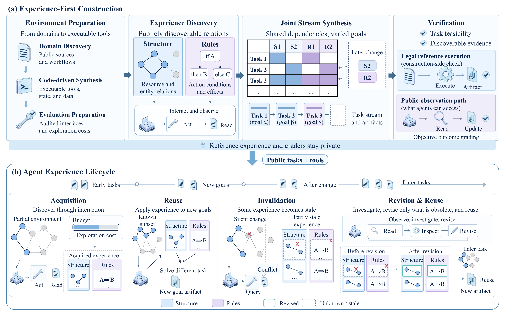
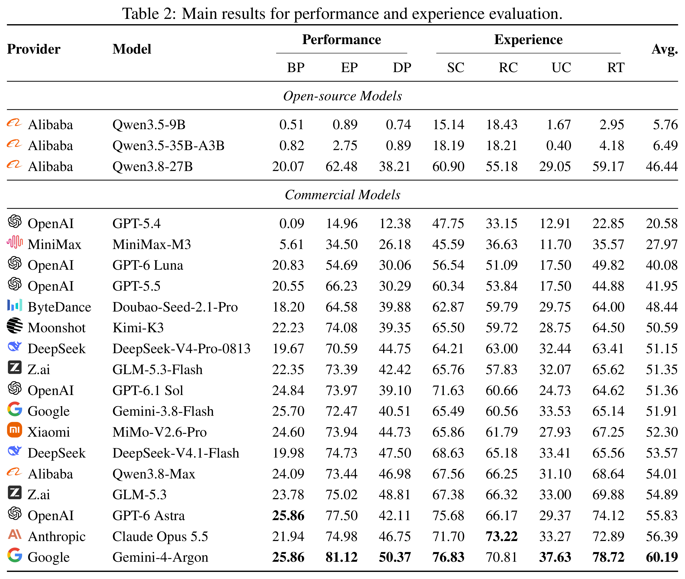

<div align="center">

<h1>🧭 ReScopeBench</h1>
<h3>🤖 Towards Robust Long-Lived Agents</h3>

<p><i>Can agents keep experience useful when their environment changes?</i></p>


[](https://rescopebench.github.io/)
[](https://huggingface.co/datasets/JoeYing/ReScopeBench)

<p>
  <b>18</b> stateful environments &nbsp;&middot;&nbsp;
  <b>352</b> tasks &nbsp;&middot;&nbsp;
  <b>26</b> drift events &nbsp;&middot;&nbsp;
  <b>20</b> evaluated models
</p>

<p>Acquire &rarr; Reuse &rarr; Detect Obsolescence &rarr; Revise &rarr; Reuse Again</p>

<p>
  <a href="#overview">Overview</a> |
  <a href="#method">Method</a> |
  <a href="#main-results">Main Results</a> |
  <a href="#installation">Installation</a> |
  <a href="#quick-start">Quick Start</a> |
  <a href="#metrics">Metrics</a> |
  <a href="#citation">Citation</a>
</p>

</div>

<a id="overview"></a>
## 🌐 Overview

**Experience that helped yesterday can become a wrong assumption today.**
Long-lived agents need more than the ability to solve a single task: they must
learn how an environment works, reuse that knowledge for new goals, and revise
the parts that become obsolete without discarding what still holds.

**ReScopeBench evaluates this experience lifecycle in executable, stateful
environments.** Tasks share local structural knowledge and operational rules;
unannounced changes selectively invalidate some of that knowledge as the stream
progresses.

- **Connected tasks, not isolated questions.** Each environment contains a
  sequential stream of 16, 24, or 32 tasks with persistent business state and
  recurring knowledge dependencies.
- **Selective changes, not a complete reset.** One, two, or three drift events
  change parts of the environment while leaving other experience valid.
- **Outcomes and experience, measured separately.** Task graders assess delivered
  results; experience metrics assess saved structural and rule knowledge and its
  revision after change.

This repository provides the **evaluation harness, model API adapters, and metric
pipeline**. The executable environments, initial states, task streams, and
evaluator assets are distributed as [cases on Hugging Face](https://huggingface.co/datasets/JoeYing/ReScopeBench).

<a id="method"></a>
## 🧩 Method

<p align="center">
  <a href="fig/method.png"></a><br>
  <sub>Experience-first construction above; acquisition, reuse, invalidation, and selective revision below.</sub>
</p>

### 🔎 1. Discover Experience

The construction process starts from reusable knowledge that can be discovered
through environment tools, rather than from unrelated task prompts. It separates
two kinds of experience:

- **Structural experience:** where resources are located, how entities are
  connected, and which interfaces provide access to them.
- **Rule experience:** the conditions, constraints, and consequences that govern
  valid actions in the local environment.

### 🔗 2. Build Task Streams

Different goals are organized around shared knowledge dependencies. During a
stream, controlled changes make selected relationships or rules obsolete, giving
the agent opportunities to investigate, revise its experience, and apply the
revision to later tasks. Reference executions establish legal solutions; outcome
graders evaluate delivered artifacts rather than requiring a unique action path.

### ⚖️ 3. Compare Two Settings

Each model completes **two independent streams per environment**:

- **w exp:** retain the agent's naturally produced memory, skills, and permitted
  history between tasks.
- **w/o exp:** clear explicit cross-task experience at task boundaries.

Both settings start from the same initial environment and follow the same task
requests, budgets, and drift schedule. Each maintains its **own evolving business
state**; clearing experience does not reset that state. Reference knowledge and
graders remain evaluator-side assets, not learner inputs.

<a id="main-results"></a>
## 📊 Main Results

The paper evaluates **20 models across all 18 environments**: three open-source
models and 17 commercial models, each under both experience settings. The results
separate task performance from the content and revision of saved experience.

<p align="center">
  <a href="fig/main_results.png"></a><br>
  <sub>Table 2 from the paper. Scores are on a 0-100 scale, higher is better, with equal weighting across environments.</sub>
</p>

- **Retained experience makes a substantial difference.** Gemini-4-Argon scores
  **81.12 with experience**, compared with **25.86 without experience**, on
  full-stream task performance.
- **Strong overall performance does not imply immediate adaptation.** Across
  the evaluated models, the highest drift-onset performance is **50.37**, and
  the highest immediate experience-updating score is **37.63**.

Drift-onset performance measures the first task after each change. It is a
boundary-task score, not a subtraction from pre-drift performance. Experience
scores measure coverage of selected reference knowledge, not all potentially
useful knowledge an agent could acquire.

<a id="installation"></a>
## 🛠️ Installation

Use **Python 3.10**, a running Docker engine with **linux/arm64** execution
support, and at least **25 GiB of free disk space**. The tested host platform is
macOS/arm64; other hosts need the ability to run linux/arm64 containers.

Clone the repository and install the Python dependencies:

```bash
git clone https://github.com/JoeYing1019/ReScopeBench.git
cd ReScopeBench

python3.10 -m venv .venv
source .venv/bin/activate
python -m pip install -r rescopebench/requirements.txt huggingface_hub
```

Download the matching cases and build the local agent runtime:

```bash
python scripts/download_cases.py
python scripts/restore_runtime.py
bash hermes_image/build_local.sh
export RESCOPE_SANDBOX_IMAGE=rescopebench-harness:local
```

The installer selects the dataset revision pinned in
[`config/cases.json`](config/cases.json) and verifies file checksums. Keep the
repository root as your working directory for the commands below.

The agent runtime builds on [Hermes Agent](https://github.com/NousResearch/hermes-agent);
its [MIT license](rescopebench/vendor/HERMES_LICENSE) accompanies the bundled runtime.

<details>
<summary><b>✅ Check the installation without calling a model</b></summary>

```bash
python scripts/download_cases.py --verify-only --local-files-only
python -m rescope_harness eval preflight --case robot
```

These commands check the installed files and the Robot case contract. They do
not launch a model evaluation.

</details>

<a id="quick-start"></a>
## 🚀 Quick Start

### ⚙️ 1. Configure a Model

Point the harness at your model endpoint and use the model ID exposed by that
service. The default example uses an OpenAI-compatible Chat Completions API.

```bash
export RESCOPE_SANDBOX=docker
export RESCOPE_PROVIDER_PROTOCOL=openai
export RESCOPE_MODEL_API=openai-chat
export PROVIDER_API=chat_completions
export OPENAI_BASE_URL=https://your-provider.example/v1
export MODEL=your-served-model-id

printf 'Model API key: '
read -r -s OPENAI_API_KEY
export OPENAI_API_KEY
printf '\n'
```

Credentials are supplied at runtime through environment variables or a secret
manager; the example uses a hidden terminal prompt.

<details>
<summary><b>🔌 Use Responses, Anthropic, or Gemini instead</b></summary>

For the Responses API, change these settings **before preparing a run**:

```bash
export RESCOPE_MODEL_API=openai-responses
export PROVIDER_API=responses
```

For native Anthropic or Gemini requests, set `RESCOPE_MODEL_API` to
`anthropic-messages` or `gemini-generate-content`, respectively, and set
`PROVIDER_API=chat_completions`. Supply the corresponding service endpoint in
`OPENAI_BASE_URL` and its credential in `OPENAI_API_KEY`.

The [configuration example](config/harness.env.example) lists the supported
settings. Use a new output directory if you change the model, API, or runtime
configuration after preparing a run.

</details>

### ▶️ 2. Run Both Settings

Prepare a paired run, verify its configuration, and execute both streams. This
example uses Robot; replace `robot` with another installed case directory name.

```bash
OUT="$PWD/results/robot-model-a"

python -m rescope_harness eval prepare \
  --case robot --output "$OUT" --model "$MODEL" \
  --provider-api "$PROVIDER_API" --tool-execution batched --execution-mode formal
python -m rescope_harness eval verify --case robot --output "$OUT"

for ARM in native reset; do
  python -m rescope_harness eval run-arm \
    --case robot --output "$OUT" --arm "$ARM" \
    --no-board-register --retry-infrastructure
done
```

The CLI names `native` and `reset` correspond to **w exp** and **w/o exp**.
Run both complete streams for every model/environment pair. Results are written
under `$OUT/native` and `$OUT/reset`, with completion recorded in each arm's
`summary.json`.

**Batched tool calls are enabled in this example.** The model can request
multiple calls in one turn. Operations execute in model order, and costs are
accounted for per operation under the environment's cost contract, not once per
batch. This is separate from running multiple streams concurrently.

<details>
<summary><b>⏯️ Start with a smoke run or continue an interrupted stream</b></summary>

For a one-task smoke run, set `RESCOPE_LIMIT=1` before executing the `run-arm`
commands. To continue the same streams afterward:

```bash
unset RESCOPE_LIMIT
```

Repeat the `run-arm` loop above with the same `$OUT`. An interrupted run can
also be continued this way. `--retry-infrastructure` allows infrastructure
failures to be retried; it is not a request to resample completed task outcomes.

</details>

<details>
<summary><b>🧵 Evaluate multiple models or environments concurrently</b></summary>

Prepare each paired run first, then populate a registry following
[`config/registry.example.json`](config/registry.example.json), with the case
name and absolute output path of each prepared run. Launch the controller:

```bash
python -m rescope_harness batch --registry registry.json \
  --output "$PWD/controllers/batch-a" --workers 2 --retry-infrastructure
```

`workers` counts concurrent arms, not tool calls. Choose it according to your
Docker resources, available disk space, and provider limits.

</details>

<a id="metrics"></a>
## 📏 Metrics

Score a **completed pair of streams**, then combine results across the same
environment set for each model. The metric pipeline reports two complementary
groups:

- **Performance:** `BP` without experience, `EP` with experience, and `DP` on
  the first task after each drift.
- **Experience:** `SC` structural coverage, `RC` rule coverage, `UC` immediate
  updating, and `RT` recovery timeliness.

These are the paper's labels. The corresponding output keys are
`B / W / D / S / R / U / H`. All seven scores are higher-is-better on a 0-100
scale; `AVG` is their arithmetic mean, with equal weighting across environments.

### 🎯 Task Performance

Compute task-performance scores directly from the paired run. No judge API is
needed:

```bash
python -m rescope_metrics performance \
  --run "$OUT" --output "$PWD/scores/robot-business.json"
```

### 📝 Experience and Reports

To obtain all seven scores, configure a judge for the saved experience. The
pipeline uses **frozen claim rubrics**, accepts equivalent expressions and
supported deductions, and aggregates claim judgments by experience unit.

Supply the judge credential without writing it into a configuration file:

```bash
printf 'Judge API key: '
read -r -s RESCOPE_JUDGE_API_KEY
export RESCOPE_JUDGE_API_KEY
printf '\n'
```

Prepare the inputs, judge them, and generate a report:

```bash
python -m rescope_metrics prepare --run "$OUT" \
  --output "$PWD/scores/robot-model-a" \
  --judge-model your-judge-model \
  --judge-base-url https://your-judge.example/v1 --judge-api responses
python -m rescope_metrics judge --output "$PWD/scores/robot-model-a" --workers 16
python -m rescope_metrics score --output "$PWD/scores/robot-model-a"
python -m rescope_metrics report \
  --inputs "$PWD"/scores/*/metrics.json --output "$PWD/reports/main"
```

Use the same judge configuration across models. Each request evaluates the
claims of one experience unit against a saved-experience snapshot. Only `judge` calls a model;
the other metric commands run locally and require no Docker container. For a
judge without reasoning-effort support, add `--reasoning-effort omit` to
`prepare`; use `--judge-api chat_completions` if required by its endpoint.

The report includes **CSV summaries, per-task performance and experience curves,
and a self-contained HTML page**. Low reference coverage does not by itself mean
an agent has no useful experience: task graders can reward other valid strategies.

<a id="citation"></a>
## 📚 Citation

If you use ReScopeBench in your research, please cite:

```bibtex
@misc{huang2026rescopebench,
  title  = {Towards Robust Long-Lived Agents: Benchmarking Experience Lifecycles in Evolving Environments},
  author = {Huang, Shijue and Guo, Hangyu and Zhang, Hengheng and An, Guo and He, Zhitao and Tian, Qi and Feng, Yiren},
  year   = {2026},
  note   = {Preprint},
  url    = {https://rescopebench.github.io/}
}
```

<a id="acknowledgements"></a>
## 🙏 Acknowledgements

This research was financially supported by the Open Research Fund from Guangdong Laboratory of Artificial Intelligence and Digital Economy (SZ), under Grant No. GML-KF-26-06.
